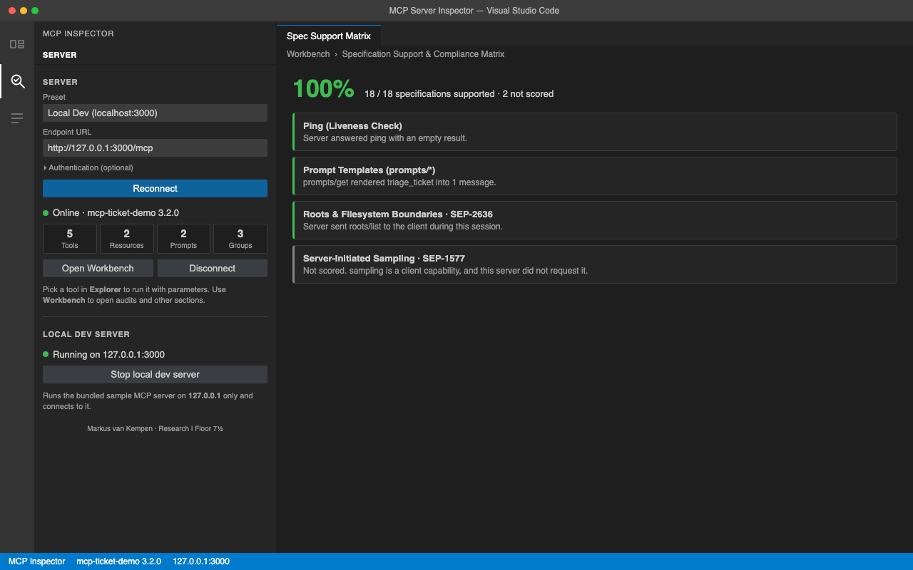
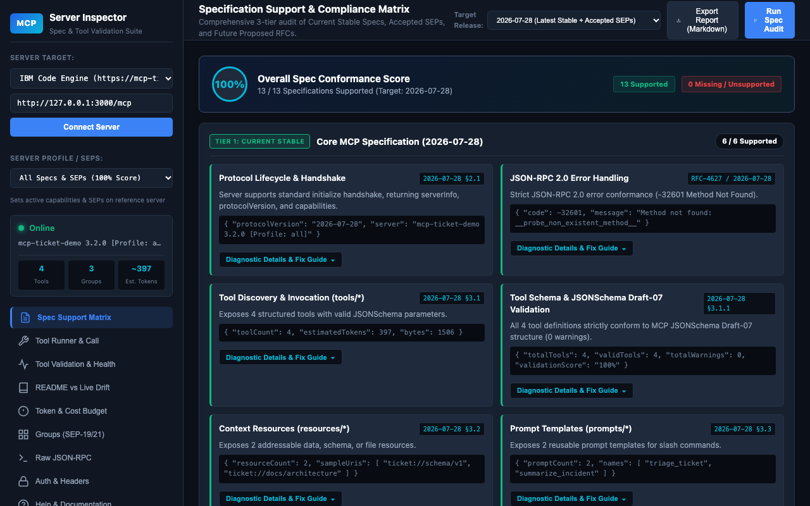
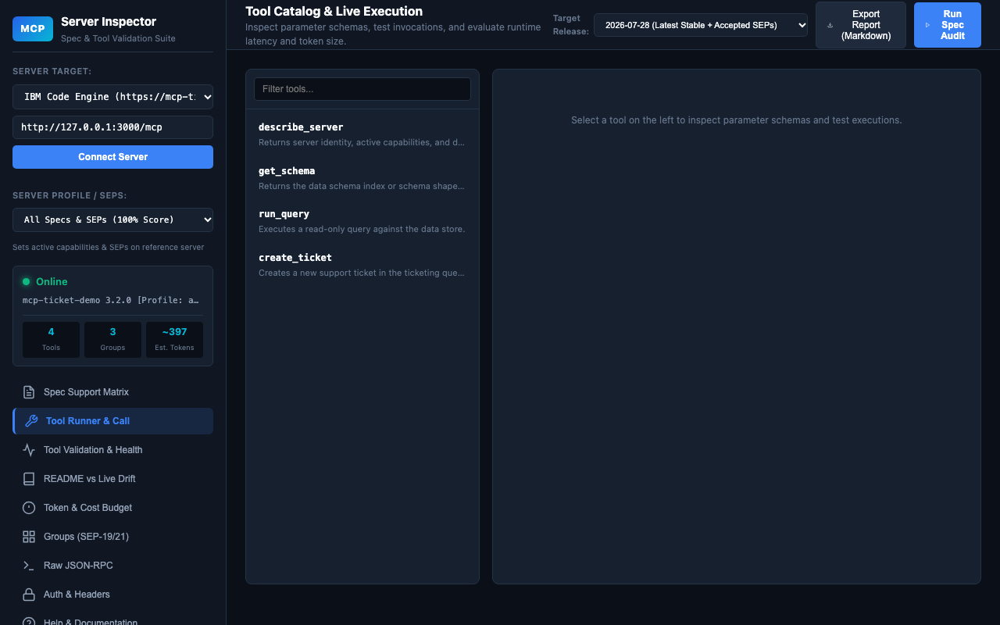
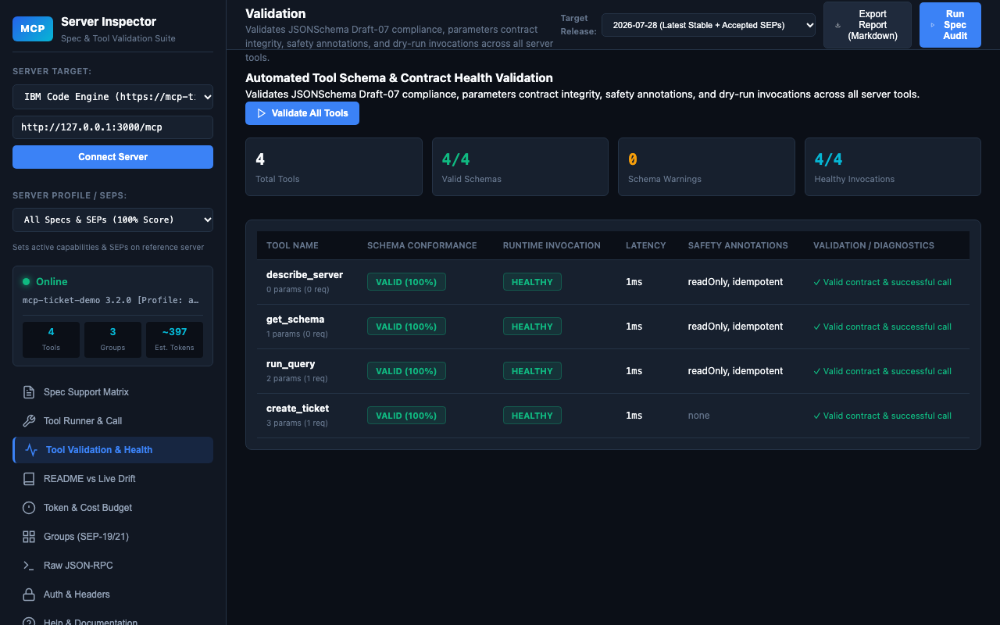
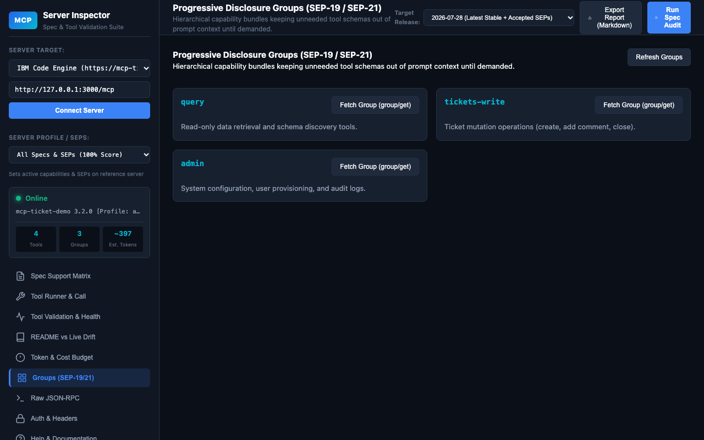

<div align="center">

# MCP Server Inspector & Spec Auditor for VS Code

**An IDE-native developer workbench and specification auditor for Model Context Protocol (MCP) servers, tool JSONSchemas, and SEPs inside Visual Studio Code.**

[](LICENSE)
[](#overview)
[](#overview)
[](https://modelcontextprotocol.io)
[](https://www.jsonrpc.org/specification)
[](https://json-schema.org/draft-07)
[](#overview)
[](https://nodejs.org)
[](#overview)
[](PRIVACY.md)

[](https://github.com/markusvankempen/mcp-server-inspector-vscode-extension/stargazers)
[](https://github.com/markusvankempen/mcp-server-inspector-vscode-extension/network/members)
[](https://github.com/markusvankempen/mcp-server-inspector-vscode-extension/issues)
[](https://github.com/markusvankempen/mcp-server-inspector-vscode-extension/commits/main)
[](https://github.com/markusvankempen/mcp-server-inspector-vscode-extension)
[](https://github.com/markusvankempen/mcp-server-inspector-vscode-extension)
[](https://github.com/markusvankempen/mcp-server-inspector-vscode-extension/pulls)



</div>

**Author:** Markus van Kempen  
[Research | Floor 7½ 🏢🤏](https://markusvankempen.github.io/)

**Topics:** `mcp` · `model-context-protocol` · `vscode-extension` · `inspector` · `json-rpc` · `jsonschema` · `spec-compliance` · `llm-tools` · `ai-agents` · `developer-tools` · `devtools` · `sse` · `streamable-http`

---

## Table of Contents

- [Overview](#overview)
- [IDE-Native Layout & Views](#ide-native-layout--views)
- [Running Tools with Parameters](#running-tools-with-parameters)
- [Bundled Local Dev Server](#bundled-local-dev-server)
- [Key Features](#key-features)
- [Screenshots](#screenshots)
- [Commands Reference](#commands-reference)
- [Extension Settings](#extension-settings)
- [Security & Secret Storage](#security--secret-storage)
- [Installation & VSIX](#installation--vsix)
- [Source Code & Access](#source-code--access)
- [Privacy Policy](#privacy-policy)
- [License](#license)

---

## Overview

The **MCP Server Inspector & Spec Auditor for VS Code** brings full Model Context Protocol server inspection, automated specification testing, tool schema auditing, and runtime diagnostics directly into your editor workflow.

Whether you are authoring a new MCP server or integrating existing ones with VS Code Copilot, Bob, Cursor, Windsurf, or Claude Desktop, you can discover tools, validate JSONSchema Draft-07 contracts, generate argument templates, invoke tools with CodeLens, and run complete 3-tier spec audits without leaving VS Code.

---

## IDE-Native Layout & Views

Click the **MCP Inspector** icon in the Activity Bar to open the side panel, featuring three coordinated views:

| View | Description |
|---|---|
| **Server** | Pick an endpoint preset or enter a custom MCP URL (`http://` or `https://`), configure optional Authorization headers and API keys, toggle the bundled local dev server, and view live discovery counts (Tools, Resources, Prompts, Groups). |
| **Explorer** | A native tree view listing all discovered **Tools**, **Resources**, **Prompts**, and **Groups**. Click any tool to open its typed argument template or invoke it; click a resource to read and inspect its contents. |
| **Workbench** | Quick-navigation tree to open any full workbench section in an editor tab (Spec Support Matrix, Tool Runner, Validation & Health, README Drift, Token Budget, Groups, Raw JSON-RPC, Auth & Headers, Help). |

```
┌─────────────────┐  ┌─────────────────────────────────────────────────────────┐
│ MCP Inspector   │  │ editor.jsonc (arguments)     │ [Result] get_weather     │
│ ├─ Server       │  │ // Run CodeLens (play)       │ {                        │
│ ├─ Explorer     │  │ {                            │   "tool": "get_weather", │
│ │  ├─ Tools     │  │   "location": "Halifax",     │   "durationMs": 42,      │
│ │  ├─ Resources │  │   "units": "celsius"         │   "result": { ... }      │
│ │  └─ Groups    │  │ }                            │ }                        │
│ └─ Workbench    │  └──────────────────────────────┴──────────────────────────┘
```

---

## Running Tools with Parameters

1. **Connect** to any MCP server in the **Server** view (or start the bundled local dev server).
2. In the **Explorer** view, click a tool (or use the inline play button, or press `Cmd+Shift+P` → **MCP Inspector: Run Tool…**).
3. If the tool accepts parameters, an **interactive arguments editor** opens in a temporary JSONC document generated directly from the tool's `inputSchema`:
   - **Required parameters** are pre-populated with typed placeholders and documentation comments derived from schema descriptions.
   - **Optional parameters** are neatly formatted as commented-out fields ready to uncomment.
4. Edit the parameter values and click the **Run** CodeLens at the top of the file (or the play button in the editor title bar).
5. The execution result opens instantly in a **read-only JSON editor side-by-side**, showing:
   - Tool name & evaluated arguments
   - `isError` boolean flag
   - Round-trip execution duration (ms)
   - Estimated token consumption and byte weight
   - Full structured server response or JSON-RPC error payload

*Tools without required parameters execute immediately with one click.*

---

## Bundled Local Dev Server

Need to test the inspector or explore MCP features without an external server running?

- Click **Start local dev server** in the **Server** view or run **MCP Inspector: Start Local Dev Server** from the Command Palette.
- The extension starts a lightweight mock MCP server listening on **`127.0.0.1` only** (configurable port, default: `3000`).
- The shared session automatically connects and discovers sample tools (`echo`, `get_weather`, `calculate`, `fetch_url`), resources, prompts, and progressive disclosure groups with full SEP support.
- Stop the server anytime via the UI or Command Palette. It also shuts down cleanly when VS Code closes.

---

## Key Features

- **3-Tier Specification Audit (0–100% Score):**
  - **Tier 1 (Core Protocol):** Handshake (`initialize`), capabilities negotiation, standard JSON-RPC 2.0 error handling (`-32601`).
  - **Tier 2 (Schema & Primitives):** JSONSchema Draft-07 compliance on all tool definitions, `resources/list`, `prompts/list`, SEP-1850 safety annotations (`readOnlyHint`, `idempotentHint`, `openWorldHint`).
  - **Tier 3 (Modern SEPs):** Workspace roots (SEP-2636), Sampling (SEP-1577), Catalog + Query pattern, Server Cards (SEP-2127), TTL caching (SEP-2549), standardized resource errors (SEP-2164), progressive disclosure groups (SEP-19 / SEP-21), tool failure classification (SEP-3313), tasks & streaming (SEP-2663 / SEP-2694), skills extension (SEP-2640), elicitation (SEP-1036), push events & webhooks (SEP-3415).
- **Interactive Tool Runner:** Schema-driven dynamic forms and JSONC argument editor with CodeLens execution.
- **Batch Dry-Run Validation Suite:** Automated dry-run tests across all server tools with schema health scores and failure categorization.
- **README Drift Analyzer:** Live semantic comparison between GitHub README markdown claims and discovered runtime server primitives.
- **Token Budgeting & Estimation:** Byte-weight and token calculations (~3.8 bytes/token standard heuristic) and group progressive disclosure savings estimation.
- **Raw JSON-RPC Console:** Direct JSON-RPC 2.0 query console with preloaded templates and Streamable HTTP / SSE support.
- **Zero Runtime Dependencies:** No external npm packages at runtime; lightning fast startup.

---

## Screenshots

| Spec Compliance Matrix | VS Code Server View |
|---|---|
|  |  |
| **Dynamic Tool Runner** | **Batch Validation & Health** |
|  |  |
| **README Drift Analyzer** | **Progressive Disclosure Groups** |
|  |  |

---

## Commands Reference

| Command ID | Title | Context / Availability |
|---|---|---|
| `mcpInspector.open` | **MCP Inspector: Open Workbench** | Always (Editor title bar, Status bar, Command Palette) |
| `mcpInspector.runTool` | **MCP Inspector: Run Tool…** | When connected (Explorer view context menu, Command Palette) |
| `mcpInspector.runToolFromEditor` | **MCP Inspector: Run Tool Arguments** | When editing tool arguments (`.jsonc` document) |
| `mcpInspector.readResource` | **MCP Inspector: Read Resource** | When connected (Explorer view context menu) |
| `mcpInspector.openTab` | **MCP Inspector: Open Workbench Section** | Navigation from tree view items |
| `mcpInspector.refresh` | **MCP Inspector: Refresh** | When connected (Explorer view title bar) |
| `mcpInspector.disconnect` | **MCP Inspector: Disconnect** | When connected (Explorer / Server view title bar) |
| `mcpInspector.startDevServer` | **MCP Inspector: Start Local Dev Server** | When local dev server is stopped |
| `mcpInspector.stopDevServer` | **MCP Inspector: Stop Local Dev Server** | When local dev server is running |

---

## Extension Settings

| Setting | Type | Default | Description |
|---|---|---|---|
| `mcpInspector.requestTimeoutMs` | `number` | `60000` | Timeout in milliseconds for each outbound request to an MCP server (1,000–300,000 ms). |
| `mcpInspector.devServer.port` | `integer` | `3000` | Port for the bundled local dev MCP server (binds strictly to `127.0.0.1`, range 1024–65535). |

---

## Security & Secret Storage

- **VS Code SecretStorage:** Authentication tokens, API keys, and custom headers are never stored in plain configuration or workspace settings. They are encrypted and persisted using VS Code's native `SecretStorage` API.
- **Strict Content-Security-Policy (CSP):** The embedded workbench webview operates under strict CSP rules without eval or direct network capabilities. Outbound HTTP requests are routed exclusively through the sandboxed extension host.
- **Local Loopback Protection:** The bundled dev server binds strictly to loopback (`127.0.0.1`).
- **No Telemetry:** Zero analytics, tracking, or external logging.

---

## Installation & VSIX

### Installing from VSIX Package
1. Download the latest `.vsix` release from GitHub releases.
2. Open VS Code and open the Command Palette (`Cmd+Shift+P` / `Ctrl+Shift+P`).
3. Select **Extensions: Install from VSIX...** and choose the downloaded file.
4. The MCP Inspector icon will appear in your Activity Bar.

---

## Source Code & Access

This repository contains **documentation only** (README, changelog, privacy policy, screenshots, and listing metadata). The VS Code extension source code and development workspace are maintained in the private repository: [`markusvankempen/mcp-server-inspector-vscode-extension-dev`](https://github.com/markusvankempen/mcp-server-inspector-vscode-extension-dev).

---

## Privacy Policy

No telemetry or analytics. See [`PRIVACY.md`](PRIVACY.md).

---

## License

Licensed under the **Apache 2.0 License**. See [`LICENSE`](LICENSE) for details.
